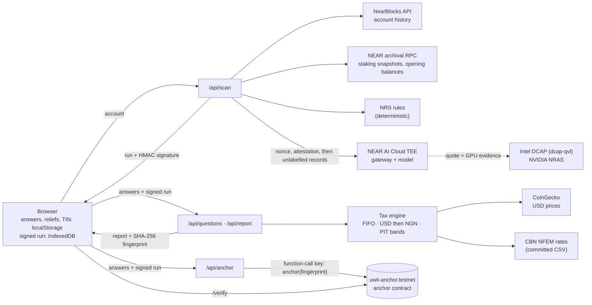

# Uwii

Uwii computes an individual's 2026 Nigerian tax on their NEAR crypto activity, line by line under NRS
Information Circular No. 2026/21. Its AI step runs in attested hardware on NEAR AI Cloud, and the finished
report's fingerprint can be anchored on NEAR testnet.

Live: <https://uwii-chi.vercel.app> · Computation for review; not tax advice.

## The problem

- Nigeria's revenue service (NRS) now taxes crypto: Information Circular No. 2026/21 (published 31 July
  2026) sets out how virtual-asset income and gains are computed for individuals.
- The first annual returns that include 2026 income are due by 31 March 2027.
- Working it out by hand needs every transaction:
  - classified as income, disposal or non-taxable;
  - priced in US dollars;
  - converted at the CBN NFEM rate;
  - run through the personal income tax bands.
- Doing that with a general AI service means handing over the full history and the reasons behind each
  payment. Uwii keeps that step in verifiable hardware and keeps the person's answers in their browser.

## Try it in 60 seconds (live site)

1. **Open the finished example.** On <https://uwii-chi.vercel.app>, click **See a finished report**.
   - You see `/result?account=rybergh44.near` with the label **Cached demo result · questions answered
     for illustration**.
   - The hero shows **₦41,231.99** with the chips **Final** and **Verified private**.
   - This path makes no AI call: it uses the committed classification of the demo account and
     illustrative answers.
2. **Open the privacy proof.** Click **Privacy proof**.
   - The panel reads **18 of 18 checks passed** and **Verified private**.
   - It lists every attestation check, and what the proof does and does not cover.
3. **Read the lines.** Scroll to the five sections (Income, Disposals and swaps, Gas fees, Not
   taxable, Excluded). Click a row: the drawer shows how that line was worked out and the circular
   paragraph it relies on.
4. **Export.** Click **Export worksheet**, then **Download PDF worksheet** or **Download CSV**. You get
   a PDF worksheet (fingerprint on page 1) and a CSV of every line.
5. **Anchor and verify.**
   - On Export, the anchor card shows **Already anchored on NEAR testnet** with the block and
     transaction for this report's fingerprint.
   - Click **Verify it**: `/verify` looks the fingerprint up on the `uwii-anchor.testnet` contract.
6. **Run it live.** Click **Run it live yourself** on the result page; this starts a real scan of
   `rybergh44.near`.
   - The scan reads the history, labels 117 of 125 transactions with the NRS rules, verifies the TEE
     attestation, and classifies the rest with the attested model.
   - Click **Answer 4 questions**, then **Fill illustrative demo answers**, then **See final result**.
   - The hosted demo allows 5 live scans per IP per hour and has a daily AI-call cap. When a limit is
     hit, the page offers **Load the cached demo report**.

## Run locally

Requirements: Node.js 22 or later and npm. Optional: Rust 1.93 for the contract tests (`rust-toolchain.toml`
pins it).

```bash
git clone https://github.com/shrooms08/uwii.git
cd uwii
npm ci
cp .env.example .env.local      # no values are needed for the cached demo
npm test                        # 132 tests
npm run build
npm start                       # http://localhost:3000
```

**Works with no keys:**
- the home page and **See a finished report**;
- the cached scan replay at `/scan?account=rybergh44.near&cached=1`;
- Questions, Result and Export for `rybergh44.near`, including the PDF and CSV;
- the guide;
- all tests.

The demo account's history, classification, prices and opening position are committed in
`data/fixtures/`; CBN NFEM rates are in `data/fx/`.

**Needs keys or settings** (names only; see `.env.example` and `docs/DEPLOY.md`):

| Feature | Variables |
| --- | --- |
| Live scans of any account | `UWII_RUN_SECRET` (signs the run the browser keeps; without it live scans return 503) and `NEAR_AI_API_KEY` (NEAR AI Cloud) |
| Looking up anchors on `/verify` (read-only) | `NEAR_NETWORK=testnet`, `NEAR_ANCHOR_CONTRACT_ID` |
| Anchoring new reports | `NEAR_ANCHOR_ACCOUNT_ID` and `NEAR_ANCHOR_PRIVATE_KEY` (a function-call key limited to `anchor`) |
| Optional | `NEAR_ARCHIVAL_RPC_URL`, `COINGECKO_DEMO_API_KEY`, `MAX_AI_CALLS_PER_DAY`, `MAX_ANCHORS_PER_DAY` |

Live scans read NearBlocks' free API (about 6 calls a minute) and a NEAR archival RPC (about one call a
minute), so a large account can take many minutes. The `/dev/*` developer pages are off in production
builds unless `UWII_ENABLE_DEV_PAGES=1`.

## Architecture



- **History.** `/api/scan` reads the account's history from NearBlocks, and staking snapshots and the
  1 January 2026 opening balances from a NEAR archival RPC.
- **Rules first.** Deterministic NRS rules label most transactions (117 of 125 in the demo). The rest
  go to the AI step.
- **Attested AI.** Before anything is sent, Uwii fetches NEAR AI Cloud's attestation report with a fresh
  nonce and verifies it: Intel TDX quote, NVIDIA GPU evidence, debug off, signer bound to the
  hardware. Each AI response is then signature-checked. Only public on-chain data is sent.
- **Signed run.** The classified run returns to the browser signed with HMAC-SHA256
  (`UWII_RUN_SECRET`) and is kept in IndexedDB. No shared server cache holds it, so one user can't
  change another's run, and any server instance can build the report.
- **Questions.** Uwii asks plain questions about the transactions the chain can't explain. Answers,
  other income, reliefs and personal details stay in the browser's localStorage and travel only in
  request bodies; the server doesn't store or log them.
- **Tax engine.** It values every line in US dollars (CoinGecko), converts at the CBN NFEM closing rate
  on the transaction date, applies FIFO cost, nets gains and losses, and charges the personal income
  tax bands marginally over other income. Every line carries its circular reference.
- **Fingerprint.** The report gets a SHA-256 fingerprint over its canonical JSON (personal fields and
  raw income and relief inputs excluded). The PDF (jsPDF, built in the browser) and the CSV print it.
- **Anchor.** A final report's fingerprint can be anchored on the `uwii-anchor.testnet` contract by a
  function-call key that can only call `anchor`. `/verify` reads it back.

## How NEAR is used, and why

- **NEAR AI Cloud private inference with attestation.** The one step that needs judgement (who paid you,
  and why) runs on NEAR AI Cloud inside a TEE. Uwii verifies the attestation on every scan and checks
  every response signature, so the claim "processed in attested hardware" can be checked, not just
  trusted. Code: `src/lib/near/attestation.ts`, `src/lib/tax/ng/classify.ts`.
- **Anchor contract on NEAR testnet.** `contracts/anchor` (Rust, near-sdk) stores
  `{fingerprint, status, block, time}` once per final report.
  - Only the owner can write, duplicates are refused, and an NEP-297 event is emitted.
  - The server holds a function-call key limited to `anchor` with a 1 NEAR allowance; it refuses to sign
    with a full-access key.
  - A timestamped, public record that this exact report existed costs a fraction of a testnet NEAR.
  - Code: `src/lib/near/anchor.ts`.
- **NEAR account history.** The tax is computed from the account's own NEAR activity: transfers, FT
  transfers, staking rewards from pool balance snapshots, gas, and NEAR Intents swaps.

## What the privacy proof covers

The same wording appears in the privacy panel and the guide (`src/content/privacy-scope.ts`).

Covers:

- Genuine Intel TDX and NVIDIA GPU hardware: the TDX quote is verified with Intel DCAP and the GPU evidence by NVIDIA's attestation service.
- Debug mode is off.
- A fresh nonce from Uwii is inside every attestation report, so the reports were made for this scan.
- The key that signs the AI's responses is bound to the attested hardware.
- Each AI response is signed over its exact bytes, and Uwii checks every signature.

Does not cover:

- A pinned allowlist of approved software builds: Uwii checks that the reported configuration matches the hardware measurement, not that it is a build it has approved.
- That TLS terminates inside the attested gateway.
- Local validation of NVIDIA's attestation token: Uwii relies on NVIDIA's service over HTTPS.
- Your answers, other income and reliefs: they are processed on Uwii's server (not in a TEE) and are not stored. The AI only ever receives public on-chain data.

## Tax correctness

- **Illustrations as tests.** The circular's worked examples are reproduced in
  `src/lib/tax/ng/engine.test.ts`:
  - Illustration 2: ₦1,000,000 at ₦1,000/$, sold for ₦1,970,000 at ₦1,500/$, gives a taxable gain of
    ₦470,000;
  - Illustration 3: a 2 ETH to 0.1 BTC swap gives a $1,000 gain, ₦1,600,000.
- **Every line cites the circular** (or the Nigeria Tax Act 2025), in the Result table, the line drawer,
  the PDF and the CSV.
- **Decisions are logged** where the circular leaves a choice, from D1 to D17, in
  [docs/rules-ng-2026-21.md](docs/rules-ng-2026-21.md). Examples: swap proceeds (D1), gas fees (D2), the
  pre-2026 cost reset (D11), reliefs (D15, D17).
- **The guide shows its sources.** The plain-English guide at `/guide` cites a paragraph for each
  claim, and marks Uwii decisions as decisions.
- **Section subtotals reconcile exactly** with the report totals (`src/lib/report/sections.test.ts`).

## Security

[docs/SECURITY-AUDIT.md](docs/SECURITY-AUDIT.md) records an audit of this code base and the resolution of
every finding:
- **Fixed:** developer pages are off in production; scans are per-user signed runs with no shared
  cache; the anchor key is function-call only; on-chain strings are sanitised before the AI and the UI;
  APIs are rate-limited and size-capped; there is a CSP and other security headers; server errors are
  generic.
- **Known limitations:** the privacy-proof gaps listed above, and in-memory per-instance limits.

## Tests

```bash
npm test                         # 132 tests (node:test via tsx): engine, rules, reports, sections, API limits, signing, anchoring
npm run lint
(cd contracts/anchor && cargo test)   # 8 contract unit tests (Rust 1.93, near-sdk 5.29)
npm run stats                    # re-measures the landing page's "Live" row into src/content/stats.json
```

The landing page's **Live** row shows only measured numbers: tests passing and NRS illustrations
reproduced (from `npm test`), reports anchored (counted from the anchor contract's state on testnet),
and privacy checks per scan (from the committed demo run). `npm run stats` refreshes them and refuses to
write if any test fails.

## Limitations

- Individuals only, NEAR accounts only, the 2026 year of assessment only.
- Computation for review, not tax advice. Reliefs follow Nigeria Tax Act 2025 s.30 as Uwii reads it
  (D17). The pre-2026 cost rule (D11) rests on public statements, not a published paragraph.
- Some things are not computed:
  - withholding tax deducted at source is not visible on-chain and is not credited;
  - VAT on professional fees is out of scope;
  - tokens without a verifiable price are left out of the totals (circular 9.2(4)).
- Anchoring uses NEAR testnet. An anchor proves a report existed at that time, not that it is correct or
  that the account owner made it; every anchor is signed by Uwii's own account.
- The privacy proof has the gaps listed above. Answers are processed on Uwii's server, not in the TEE.
- The hosted demo has a 300-second function limit, so very large accounts may not finish a live scan.
  Rate limits and daily caps are kept in memory per server instance.
- On mobile Lighthouse runs, Result and Export score 86 to 87 on performance: the report is drawn after
  the browser sends its saved answers to the API.

## Hackathon disclosures

- **Event and tracks.** Built in November 2026 (first commit 2026-11-04) for the NEAR HACKATHON, in the
  Privacy & Private AI and Real-World Money tracks.
- **Second project.** The author also submits **Vigil**, an independent project: a NEAR memecoin with an
  AI Keeper. The two projects share no code.
- **AI assistance.** The code was written with an AI coding assistant (Claude Code); commits carry a
  co-author line.
- **Templates.**
  - The web app started from a `create-next-app` scaffold (in the first code commit, "Phase 1").
  - The anchor contract started from the cargo-near project template (its `Cargo.toml` keeps the
    template's reproducible-build settings).
  - No other code was copied from other projects.
- **Data sources:**
  - NearBlocks API ("Powered by NearBlocks.io APIs");
  - NEAR archival RPC and FastNEAR (neardata);
  - CoinGecko public API;
  - Rhea / Ref Finance pools (on-chain);
  - CBN NFEM closing rates (committed CSV);
  - NEAR AI Cloud; Intel PCS (via dcap-qvl); NVIDIA NRAS.
- **Libraries** (all from npm or crates.io, each under its own licence):

| Library | Version | Licence | Used for |
| --- | --- | --- | --- |
| next | 16.4.5 | MIT | Web app and API routes |
| geist | 1.9.2 | OFL-1.1 (Vercel) | Geist and Geist Mono, bundled at build time (no font is fetched) |
| react, react-dom | 19.3.0 | MIT | UI |
| near-api-js | 7.3.1 | MIT and Apache-2.0 | Anchor transactions, RPC |
| @phala/dcap-qvl | ^0.7.1 | Apache-2.0 | Intel TDX quote verification |
| openai | ^7.50.0 | Apache-2.0 | Client for NEAR AI Cloud's OpenAI-compatible API |
| ethers | ^6.17.0 | MIT | Checking AI response signatures |
| decimal.js | 10.6.0 | MIT | Exact decimal money arithmetic |
| zod | ^4.6.7 | MIT | Input validation |
| jspdf, jspdf-autotable | 4.2.1, 5.0.9 | MIT | PDF worksheet in the browser |
| tailwindcss, @tailwindcss/postcss | 4.3.3 | MIT | Styling |
| near-sdk (crate) | 5.29 | MIT or Apache-2.0 | Anchor contract |
| Dev: typescript, eslint, eslint-config-next, tsx, playwright | see `package.json` | Apache-2.0 / MIT | Build, lint, tests, screenshots |

- **Fonts** (SIL Open Font License 1.1):
  - Geist and Geist Mono (Vercel), for all text, figures and the glyph art;
  - IBM Plex Mono (the ₦ sign in the PDF and the social cards).
- **Artwork.** The landing hero draws Marinus van Reymerswaele's *The Tax Collectors* (1540s, public
  domain) in gold text characters, full-bleed, with an intro decode, brief glitches and a cursor light
  (one static frame under reduced motion). `npm run glyph-art` rebuilds the committed, full-tone
  luminance grid (`src/content/glyph-art.json`) from the Wikimedia Commons file. Source, licence and the visual
  reference are recorded in [docs/CREDITS.md](docs/CREDITS.md).
  - Licence files are in `public/pdf-fonts/`. The web app gets the same families from the `geist` npm package: they are bundled at build time, so building needs no network beyond the npm registry.

## Licence

MIT, see [LICENSE](LICENSE) (Copyright (c) 2026 MINOS). Third-party libraries, fonts and data keep their
own licences, listed above.

Powered by NearBlocks.io APIs.
