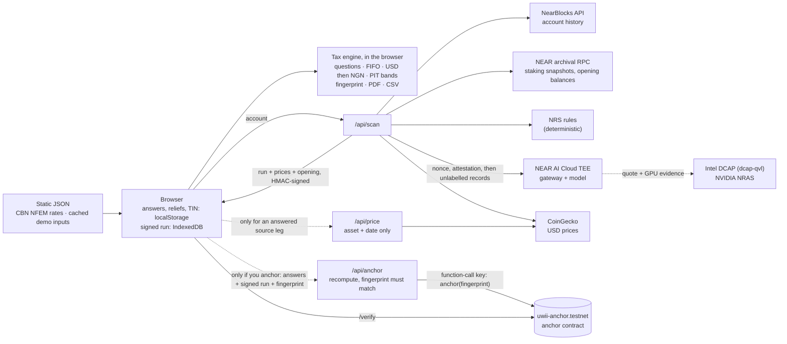

# Uwii

**Know your crypto tax. Tell no one.**

Paste your NEAR account and Uwii works out your 2026 Nigerian crypto tax. The AI runs in verified, sealed hardware, and your answers stay on your device.

Every line cites NRS Information Circular No. 2026/21, the report is computed in the browser, and
its fingerprint can be anchored on NEAR testnet.

Live: <https://uwii-chi.vercel.app> · Computation for review; not tax advice.

## Why it matters

- NRS Information Circular No. 2026/21 (published 31 July 2026) sets out how individuals' virtual-asset
  income and gains are taxed for the 2026 year of assessment.
- The first annual returns that include 2026 income are due by 31 March 2027.
- Nigeria ranks 3rd in Chainalysis's
  [2026 Global Crypto Adoption Index](https://www.chainalysis.com/blog/2026-global-crypto-adoption-index/).
- By hand, every transaction has to be classified (income, disposal or not taxable), priced in US dollars,
  converted at the CBN NFEM rate and run through the personal income tax bands.
- A general AI service would need the full history and the reasons behind each payment. Uwii keeps the
  AI step in verifiable hardware and keeps the person's answers in their browser.
- Other crypto-tax apps upload your whole financial life. Uwii's server never sees your answers. The one exception: your answers reach Uwii only if you choose to anchor; even then, your
  name, TIN and state are never sent.

## Who it's for

- Individuals with NEAR activity filing 2026 Nigerian returns.
- Tax consultants and accounting firms preparing client worksheets. A firm can use it tomorrow: scan the
  client's account, answer the questions with the client, and hand over the PDF and CSV, which carry the
  circular reference for every line and the report's fingerprint (anchorable on-chain).

## Try it in 60 seconds (live site)

1. **Open the finished example.** On <https://uwii-chi.vercel.app>, click **See a finished report** (the
   button loads the illustrative answers into your browser; typing the URL does not).
   - It opens `/result?account=rybergh44.near` with the label **Cached demo result · questions answered
     for illustration**.
   - The hero shows **₦41,231.99** with the chips **Final** and **Verified private**.
   - This path makes no AI call: it uses the committed classification of the demo account.
   - Opening `/result?account=rybergh44.near` directly shows **Draft** until the questions are answered,
     by design.
2. **Open the privacy proof.** Click **Privacy proof**: **18 of 18 checks passed** and **Verified
   private**, every attestation check, and what the proof does and does not cover.
3. **Read the lines.** Scroll to the five sections (Income, Disposals and swaps, Gas fees, Not taxable,
   Excluded). Click a row: the drawer shows how that line was worked out and the circular paragraph it
   relies on.
4. **Export.** Click **Get your crypto tax report**, then **Download PDF worksheet** or **Download CSV**: a PDF
   worksheet (fingerprint on page 1) and a CSV of every line.
5. **Anchor and verify.**
   - On Export, the anchor card shows **Already anchored on NEAR testnet** with the block and
     transaction for this report's fingerprint.
   - Click **Verify it**: `/verify` looks the fingerprint up on the `uwii-anchor.testnet` contract.
6. **Run it live.** Click **Run it live yourself** on the result page.
   - For the demo account the scan uses the committed history snapshot (the page says so), labels 117 of
     125 transactions with the NRS rules, verifies the TEE attestation, and classifies the rest live
     with the attested model.
   - Click **Answer … questions**, then **Fill illustrative demo answers**, then **See final result**.
   - The hosted demo allows 5 live scans per IP per hour and has a daily AI-call cap. When a limit is
     hit, the page offers **Load the cached demo report**.

## Run locally

Requirements: Node.js 22 or later and npm. Optional: Rust 1.93 for the contract tests
(`contracts/anchor/rust-toolchain.toml` pins it).

```bash
git clone https://github.com/shrooms08/uwii.git
cd uwii
npm ci
cp .env.example .env.local      # no values are needed for the cached demo
npm test                        # 168 tests
npm run build                   # also writes public/static-data/ from data/ (npm run static-data)
npm start                       # http://localhost:3000 (npm start -- -p 3100 for another port)
```

**Works with no keys:** the home page and **See a finished report**, the cached scan replay at
`/scan?account=rybergh44.near&cached=1`, Questions, Result and Export for `rybergh44.near` (PDF and CSV
included), the guide, and all tests. The demo account's history, classification, prices and opening
position are committed in `data/fixtures/`; CBN NFEM rates are in `data/fx/`.

**Needs keys or settings** (names only; see `.env.example` and `docs/DEPLOY.md`):

| Feature | Variables |
| --- | --- |
| Live scans of any account | `UWII_RUN_SECRET` (signs the run the browser keeps; without it live scans return 503) and `NEAR_AI_API_KEY` (NEAR AI Cloud) |
| Looking up anchors on `/verify` (read-only) | `NEAR_NETWORK=testnet`, `NEAR_ANCHOR_CONTRACT_ID` |
| Anchoring new reports | `NEAR_ANCHOR_ACCOUNT_ID` and `NEAR_ANCHOR_PRIVATE_KEY` (a function-call key limited to `anchor`) |
| Optional | `NEAR_ARCHIVAL_RPC_URL`, `COINGECKO_DEMO_API_KEY`, `MAX_AI_CALLS_PER_DAY`, `MAX_ANCHORS_PER_DAY`, `SCAN_MAX_TXNS` (default 1500), `SCAN_TIME_BUDGET_MS` |

Live scans read NearBlocks' free API (about 6 calls a minute), and staking snapshots and opening balances
from FastNEAR's archival RPC, falling back to the public archival RPC (about one call a minute), so a
large account can take many minutes. The `/dev/*` developer pages are off in production builds unless
`UWII_ENABLE_DEV_PAGES=1`.

## Architecture



Your answers, other income, reliefs and personal details are processed in your browser and sent to Uwii only if you choose to anchor; even then, your name, TIN and state are never sent.

- **History.** `/api/scan` reads the account's history from NearBlocks, and staking snapshots and the
  1 January 2026 opening balances from a NEAR archival RPC.
- **Rules first.** Deterministic NRS rules label most transactions (117 of 125 in the demo). The rest
  go to the AI step.
- **Attested AI.** Before anything is sent, Uwii fetches NEAR AI Cloud's attestation report with a fresh
  nonce and verifies it: Intel TDX quote, NVIDIA GPU evidence, debug off, signer bound to the
  hardware. Each AI response is then signature-checked. Only public on-chain data is sent.
- **Prices in the run.** Alongside the AI step, the scan reads the USD price of every record and fee at
  its time, NEAR at every record's time, and the 31 December 2025 price of each opening holding.
- **Signed run.** The classified run, its prices and the opening position return to the browser signed
  with HMAC-SHA256 (`UWII_RUN_SECRET`) and are kept in IndexedDB. No shared server cache holds them, so
  one user can't change another's run.
- **Questions and report, in the browser.** Uwii asks plain questions about the transactions the chain
  can't explain. Answers, other income, reliefs and personal details stay in the browser's localStorage,
  and the question flow, the tax engine, the fingerprint, the PDF and the CSV all run there, from the
  signed run and two static files built from `data/` (the CBN NFEM table and the cached demo's inputs).
  If an answer adds a source leg the scan did not price, the browser asks `GET /api/price` for that asset
  and date; the request carries nothing else.
- **Tax engine.** It values every line in US dollars (CoinGecko), converts at the CBN NFEM closing rate
  on the transaction date, applies FIFO cost, nets gains and losses, and charges the personal income
  tax bands marginally over other income. Every line carries its circular reference.
- **Fingerprint.** The report gets a SHA-256 fingerprint over its canonical JSON (personal fields and
  raw income and relief inputs excluded). The PDF (jsPDF, built in the browser) and the CSV print it.
- **Anchor, only if you choose.** Before the button, the page says: "To anchor, Uwii's server recomputes
  your report from your answers to confirm it is final, then writes only the fingerprint on-chain. Your
  answers are not stored." `/api/anchor` verifies the signed run, recomputes the report with the same
  code, and anchors only a final report whose fingerprint equals the browser's, on the
  `uwii-anchor.testnet` contract, with a function-call key that can only call `anchor`. Name, TIN and
  state are never sent. `/verify` reads the anchor back.

## Built with the NEAR ecosystem

- **NEAR AI (NEAR AI Cloud):** private, attested inference for the transactions the rules can't label. The
  attestation is verified with a fresh nonce on every scan and every response signature is checked
  (`src/lib/near/attestation.ts`, `src/lib/tax/ng/classify.ts`).
- **Rhea:** on-chain pool prices for tokens CoinGecko does not list, from the Rhea (Ref Finance) pool
  pairing the token with wNEAR, read at the transaction's block (`src/lib/prices/refpool.ts`).
- **NEAR Intents:** transfers from `intents.near` in the account history get their own question; answered
  as "A swap I made on NEAR Intents", they are taxed as swaps, including a source leg the user supplies
  (`src/lib/tax/ng/questions.ts`, `src/lib/tax/ng/source-leg.ts`).

## How NEAR is used, and why

- **NEAR AI Cloud private inference with attestation.** The one step that needs judgement (who paid you,
  and why) runs on NEAR AI Cloud inside a TEE. Uwii verifies the attestation on every scan and checks
  every response signature, so the claim "processed in attested hardware" can be checked, not just
  trusted. Code: `src/lib/near/attestation.ts`, `src/lib/tax/ng/classify.ts`.
- **Anchor contract on NEAR testnet.** `contracts/anchor` (Rust, near-sdk) stores
  `{fingerprint, status, block, time}` once per final report.
  - Only the owner can write, duplicates are refused, and an NEP-297 event is emitted.
  - The server holds a function-call key limited to `anchor` with a 1 NEAR allowance; it refuses to sign
    with a full-access key.
  - A timestamped, public record that this exact report existed costs a fraction of a testnet NEAR.
  - Code: `src/lib/near/anchor.ts`.
- **NEAR account history.** The tax is computed from the account's own NEAR activity: transfers, FT
  transfers, staking rewards from pool balance snapshots, gas, and NEAR Intents swaps.

## What the privacy proof covers

The same wording appears in the privacy panel and the guide (`src/content/privacy-scope.ts`).

Covers:

- Genuine Intel TDX and NVIDIA GPU hardware: the TDX quote is verified with Intel DCAP and the GPU evidence by NVIDIA's attestation service.
- Debug mode is off.
- A fresh nonce from Uwii is inside every attestation report, so the reports were made for this scan.
- The key that signs the AI's responses is bound to the attested hardware.
- Each AI response is signed over its exact bytes, and Uwii checks every signature.

Does not cover:

- A pinned allowlist of approved software builds: Uwii checks that the reported configuration matches the hardware measurement, not that it is a build it has approved.
- That TLS terminates inside the attested gateway.
- Local validation of NVIDIA's attestation token: Uwii relies on NVIDIA's service over HTTPS.
- Your answers, other income, reliefs and personal details are processed in your browser and sent to Uwii only if you choose to anchor; even then, your name, TIN and state are never sent. They never reach the TEE: the AI only ever receives public on-chain data.

## Tax correctness

- **Illustrations as tests.** The circular's worked examples are reproduced in
  `src/lib/tax/ng/engine.test.ts`:
  - Illustration 2: ₦1,000,000 at ₦1,000/$, sold for ₦1,970,000 at ₦1,500/$, gives a taxable gain of
    ₦470,000;
  - Illustration 3: a 2 ETH to 0.1 BTC swap gives a $1,000 gain, ₦1,600,000.
- **Every line cites the circular** (or the Nigeria Tax Act 2025), in the Result table, the line drawer,
  the PDF and the CSV.
- **Decisions are logged** where the circular leaves a choice, from D1 to D17, in
  [docs/rules-ng-2026-21.md](docs/rules-ng-2026-21.md). Examples: swap proceeds (D1), gas fees (D2), the
  pre-2026 cost reset (D11), reliefs (D15, D17).
- **The guide shows its sources.** The plain-English guide at `/guide` cites a paragraph for each
  claim, and marks Uwii decisions as decisions.
- **Section subtotals reconcile exactly** with the report totals (`src/lib/report/sections.test.ts`).

## Security

[docs/SECURITY-AUDIT.md](docs/SECURITY-AUDIT.md) records an audit of this code base and the resolution of
every finding:
- **Fixed:** developer pages are off in production; scans are per-user signed runs with no shared
  cache; the anchor key is function-call only; on-chain strings are sanitised before the AI and the UI;
  APIs are rate-limited and size-capped; there is a CSP and other security headers; server errors are
  generic.
- **Known limitations:** the privacy-proof gaps listed above, and in-memory per-instance limits.

## Verify the claims yourself

| Command | What it proves |
| --- | --- |
| `npm test` | 168 tests (node:test via tsx): the engine, including circular Illustrations 2 and 3; rules; report sections that reconcile with the totals; API limits; run signing; anchoring; the fault switch and every service-failure fallback (`src/lib/server/resilience.test.ts`); browser/server parity, the same report and fingerprint from the browser's code path (`src/lib/report/client-parity.test.ts`) |
| `npm run lint` | ESLint is clean |
| `npm run build && npm run test:privacy` | Playwright network canary on the production build (`scripts/privacy-canary.ts`): canary income, rent, TIN and name never appear in any request; only the anchor request carries answers, and never the name or TIN |
| `(cd contracts/anchor && cargo test)` | 8 contract tests: owner only, duplicates and non-final reports refused, input checks, NEP-297 event (Rust 1.93, near-sdk 5.29) |
| `npm run check:attestation` | Needs `NEAR_AI_API_KEY` in `.env.local`. Fetches NEAR AI Cloud's attestation with a fresh nonce, sends one sample classification, and prints PASS or FAIL for each of the 18 checks |
| `npm ci`, then `npm run build` with the network off | The build needs no network: fonts come from the `geist` package and static data from `data/` |
| `npm run stats` | Re-measures the landing page's **Live** row (tests passing, illustrations reproduced, reports anchored on testnet as of the measurement date) into `src/content/stats.json`; refuses to write if any test fails. The row's privacy-checks figure comes from the committed demo run |

## Limitations

- Individuals only, NEAR accounts only, the 2026 year of assessment only.
- Computation for review, not tax advice. Reliefs follow Nigeria Tax Act 2025 s.30 as Uwii reads it
  (D17). The pre-2026 cost rule (D11) rests on public statements, not a published paragraph.
- Some things are not computed:
  - withholding tax deducted at source is not visible on-chain and is not credited;
  - VAT on professional fees is out of scope;
  - tokens without a verifiable price are left out of the totals (circular 9.2(4)).
- Anchoring uses NEAR testnet. An anchor proves a report existed at that time, not that it is correct or
  that the account owner made it; every anchor is signed by Uwii's own account.
- The privacy proof has the gaps listed above. Answers are processed in the browser; anchoring sends them
  to Uwii's server once, to recompute the report, and they are not stored.
- The hosted demo has a 300-second function limit:
  - scans stop at about 250 seconds with a clear message;
  - accounts with more 2026 transactions than `SCAN_MAX_TXNS` are declined up front (300 on the live
    site; the code default is 1,500);
  - an account that staked all year may end as **Draft**, because reading a daily snapshot for every pool
    and day takes longer than the time budget; the result names the reason (staking rewards could not be
    read) and offers another scan.
- Rate limits and daily caps are kept in memory per server instance.
- Scans saved in the browser before commit `9832424` carry no prices, so the result asks for a new scan.
- When an outside service fails, a scan degrades instead of breaking:
  - NEAR AI unavailable or attestation failed: the transactions go to your questions, the run makes no
    private-AI claim, and the report can still become final once answered.
  - NearBlocks busy: a clear message within about a minute, and the cached demo is offered.
  - Archival RPC or CoinGecko busy: the report stays a draft and says what is missing.
- On mobile Lighthouse runs, Result and Export score 85 to 88 on performance: the report is drawn after
  the browser loads the tax engine and its static tables and computes it.

## What's next (plans, not features)

- Consultant mode: several client accounts in one workspace.
- Exchange CSV imports (Binance, Bybit, P2P) and other chains (Ethereum, Solana, Tron) (plan).
- Consultant mode with a firm's tax reserve held in a NEAR multisig (e.g. Trezu or NEAR Business) (plan).
- Anchoring on NEAR mainnet.
- More NEAR protocols, then other chains.
- Rule packs for other jurisdictions; the Nigerian rules already live in `src/lib/tax/ng`.
- Withholding-tax credits from uploaded certificates.

## Hackathon disclosures

- **Event and tracks.** Built in November 2026 (first commit 2026-11-04) for the NEAR HACKATHON, in the
  Privacy & Private AI and Real-World Money tracks.
- **AI assistance.** The code was written with an AI coding assistant (Claude Code); commits carry a
  co-author line.
- **Templates.**
  - The web app started from a `create-next-app` scaffold (in the first code commit, "Phase 1").
  - The anchor contract started from the cargo-near project template (its `Cargo.toml` keeps the
    template's reproducible-build settings).
  - No other code was copied from other projects.
- **Data sources:**
  - NearBlocks API ("Powered by NearBlocks.io APIs");
  - NEAR archival RPC and FastNEAR (neardata);
  - CoinGecko public API;
  - Rhea / Ref Finance pools (on-chain);
  - CBN NFEM closing rates (committed CSV);
  - NEAR AI Cloud; Intel PCS (via dcap-qvl); NVIDIA NRAS.
- **Libraries** (all from npm or crates.io, each under its own licence):

| Library | Version | Licence | Used for |
| --- | --- | --- | --- |
| next | 16.4.5 | MIT | Web app and API routes |
| geist | 1.9.2 | OFL-1.1 (Vercel) | Geist and Geist Mono, bundled at build time (no font is fetched) |
| react, react-dom | 19.3.0 | MIT | UI |
| near-api-js | 7.3.1 | MIT and Apache-2.0 | Anchor transactions, RPC |
| @phala/dcap-qvl | ^0.7.1 | Apache-2.0 | Intel TDX quote verification |
| openai | ^7.50.0 | Apache-2.0 | Client for NEAR AI Cloud's OpenAI-compatible API |
| ethers | ^6.17.0 | MIT | Checking AI response signatures |
| decimal.js | 10.6.0 | MIT | Exact decimal money arithmetic |
| zod | ^4.6.7 | MIT | Input validation |
| jspdf, jspdf-autotable | 4.2.1, 5.0.9 | MIT | PDF worksheet in the browser |
| tailwindcss, @tailwindcss/postcss | 4.3.3 | MIT | Styling |
| near-sdk (crate) | 5.29 | MIT or Apache-2.0 | Anchor contract |
| Dev: typescript, eslint, eslint-config-next, tsx, playwright | see `package.json` | Apache-2.0 / MIT | Build, lint, tests, screenshots |

- **Fonts** (SIL Open Font License 1.1):
  - Geist and Geist Mono (Vercel), for all text, figures and the glyph art;
  - IBM Plex Mono (the ₦ sign in the PDF and the social cards).
- **Artwork.** The landing hero draws Marinus van Reymerswaele's *The Tax Collectors* (1540s, public
  domain) in gold text characters, full-bleed, with an intro decode, brief glitches and a cursor light
  (one static frame under reduced motion). `npm run glyph-art` rebuilds the committed, full-tone
  luminance grid (`src/content/glyph-art.json`) from the Wikimedia Commons file. Source, licence and the visual
  reference are recorded in [docs/CREDITS.md](docs/CREDITS.md).
  - Licence files are in `public/pdf-fonts/`. The web app gets the same families from the `geist` npm package: they are bundled at build time, so building needs no network beyond the npm registry.

## Licence

MIT, see [LICENSE](LICENSE) (Copyright (c) 2026 MINOS). Third-party libraries, fonts and data keep their
own licences, listed above.

Powered by NearBlocks.io APIs.
